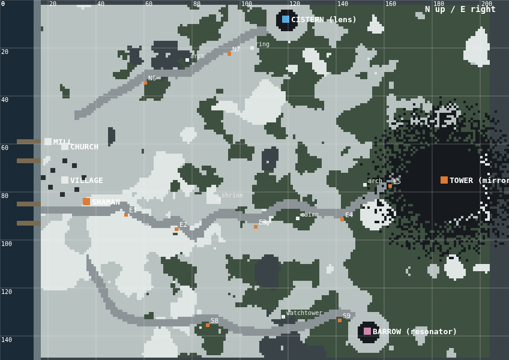

# Keeper of the Cold Lights

A small top-down survival walk in cold ink and one ember colour. Single HTML file, no dependencies, no build step.

**Play:** open `index.html` in a browser, or enable GitHub Pages on this repo (Settings → Pages → deploy from `main`, root) and play it at the Pages URL. Works on phones.

## The walk

An old man drums at the edge of a village surrounded by wolves. Past the wolves are the Watchers, who wear whatever they last touched. He sends you east to a tower of black glass for the first of three objects, then gives you a hide map for the other two. Each one is locked behind a hand puzzle, changes the world when you carry it, and goes back to him. When all three are set, he assembles them, a Mandelbrot grows in the obsidian, and a column of light stands up over the village.

| Leg   | Site     | Object                     | Puzzle                                   | While carrying                                          |
|-------|----------|----------------------------|------------------------------------------|---------------------------------------------------------|
| East  | Tower    | Obsidian mirror, in a stone trunk | Four linked stones; each turns its neighbour | Woods burn around it; hollows come for your light   |
| North | Cistern  | Lighthouse lens            | Turn five glass panels to walk a beam to the core | River freezes, wolves cross; your lantern light orbits |
| South | Barrow   | Resonator, in a stone box  | Play back the first phrase of tonight's song | It hums; the Watchers close in, faster if you stand still |

## Controls

- **Hold and drag anywhere** to walk. **Tap** to light or put out the lantern.
- Keyboard: arrows / WASD to walk, Space or L for the lantern.
- Close-ups (beacons, puzzles, the well, the old man): tap the objects; tap the strip at the bottom to step back.
- Map: tap the map icon once he has given it to you.

## Systems, briefly

- **Oil** burns while the lantern is lit. Cans lie along the paths; three in ten beside someone who didn't make it.
- **Stamina** drains faster off the trail and hauling the chain; standing in a lit beacon refills it. Wolf bites shrink its maximum for good. A mushroom in the village well slows the drain for the rest of the game.
- **Beacons** are lit by hand: slide the capstone, turn the wheel until the hollow fills, touch your flame to the wick. On the way back each one gives a burst of speed.
- **Labyrinths** are carved fresh on every entry.
- **Audio** is all procedural Web Audio: wind with gusts that drive the foreground snow and your cape, footsteps per surface, and the old man's 8-bar song (frame drum, chant, flute) varied per session but always in key.
- Contact with a Watcher fades to black; you wake by his fire with a little less in you.

## Repo

- `index.html` — the whole game.
- `docs/world-map.png` — overhead render of the world straight from the terrain function.
- `skills/one-truth-many-senses/SKILL.md` — the design principle behind the wind/snow/cape coupling, written up as a reusable skill.

Built with Claude.
